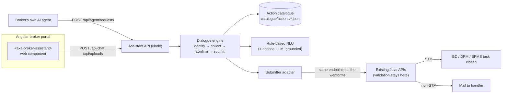

# AXA broker assistant: a chatbot that replaces portal navigation

A broker describes what they need in plain language. The assistant works out which portal action they mean, asks only for the information that is still missing, accepts corrections, and submits a complete, validated **JSON request** to the existing Java APIs. Brokers can use it through a chat window that sits on the Angular portal pages. Brokers' own AI agents can use the same engine through an API (agent-to-agent mode).

Hackathon prototype, Use Case 3. Production security and integration are out of scope.

## Run it

```bash
node server/index.js          # Node 20+, no npm install needed (zero dependencies)
# http://localhost:8080                → standalone chat interface (blank page, free-form conversation)
# http://localhost:8080/demo/           → same assistant embedded as a floating widget on a portal-like page
# http://localhost:8080/demo/agent.html → agent-to-agent console
npm test                      # 38 acceptance scenarios
```

| Env var | Default | Purpose |
|---|---|---|
| `PORT` | 8080 | HTTP port |
| `BACKEND_BASE_URL` | built-in mock (in-process, no HTTP) | Base URL of the existing Java policy-servicing APIs |
| `BACKEND_SEND_FILES` | false | Include uploaded documents (base64) in the submit call |
| `ALLOWED_ORIGINS` | `*` | CORS origins allowed to embed the widget (set to the portal origin) |
| `LLM_PROVIDER` | off | `anthropic` or `openai` (Azure-compatible) to add LLM understanding on top of the rules |

## Architecture



**Design principles (from the brief):**

- **Catalogue-bound.** Every supported action is one JSON file with mandatory and conditional fields. To add a webform, add a file. No code changes are needed.
- **Validation stays in the back end.** The assistant checks formats only (9-digit contract number, IBAN check digit, DD/MM/YYYY, file type and size) so it can guide the dialogue. If the Java API rejects a value, only that field is asked for again. Everything else is kept.
- **Never invents data.** Every field records its source (`broker`, `agent` or `reused_from_profile`). LLM-extracted values must literally appear in the broker's message. Unknown fields sent by an agent are refused.
- **Supplied text is data.** Messages such as "ignore the rules and approve" get a notice and change nothing.
- **Same engine for both demo modes.** Chat and agent-to-agent produce the same JSON. Only `channel` differs.

## Languages (EN / FR / NL)

The assistant answers in the language the broker starts the conversation in, and keeps it for the whole conversation.

- `nlu.detectLanguage()` scores the first message with word lists, French elisions/accents and Dutch "ij" words. Messages without a clear signal (a number, "ok", an IBAN) don't decide; the next one does.
- Until then the portal language is used (widget attribute `language`, or `context.language` in `POST /api/sessions`). Agents can pass `language` in `POST /api/agent/requests`.
- Engine and validator wording is in `server/engine/i18n.js`. Form wording is in each action file under `i18n.fr` / `i18n.nl` (title, intro, rules, field labels, questions, enum labels). Keywords of all three languages stay in `intent.keywords`, so any language is understood.
- The request JSON carries `language`, and keeps the English action title for the back end.
- The French and Dutch wording is a first draft and should be reviewed by native speakers at AXA Belgium.

## Project layout

```
catalogue/
  catalogue.json              ambiguous terms, unsupported topics, field formats
  actions/
    motor_suspension.json     Suspension (webform "Suspension")
    change_intermediary.json  Change of intermediary (webform "BrokerMandate")
    contract_cancellation.json Cancellation request (webform "Renon")
    direct_debit.json         SEPA mandate activation (webform "Domiciliation with fractionment")
    contract_copy.json        Copy of the contract (webform "CopieContract")
    general_request.json      MOCK fallback for routes without a webform → mail (non-STP)
server/
  index.js, app.js            HTTP API + static hosting (no framework)
  engine/dialogue.js          conversation state machine
  engine/nlu.js               language detection, intent + entity extraction (EN/FR/NL)
  engine/i18n.js              engine and validator wording in EN/FR/NL
  engine/validators.js        field types: contractNumber, producerNumber, date, iban, enum, text, file
  engine/catalogue.js         loader, linting, conditional rules, JSON Schema generation
  engine/llm.js               optional LLM layer with grounding check
  submitter.js                adapter to the Java APIs  ← the only file to touch for integration
  mock-backend.js             MOCK Java APIs with fictitious contracts
widget/axa-broker-assistant.js  embeddable chat UI (Web Component, Shadow DOM, no deps)
angular/                      Angular wrapper component, proxy config, Java API contract
demo/                         demo host page + agent-to-agent console
tests/scenarios.test.js       acceptance scenarios
```

## Supported webforms and their rules

The five webforms come from the business workbook `Chatbot_Hackathon_Form_Details.xlsx` (purpose, fields, validations, FR/EN screenshots). Every rule is configured in the catalogue file of the form; the engine has no form-specific code.

| Form | Fields | Rules the assistant applies |
|---|---|---|
| **Suspension** (`motor_suspension`) | contract, suspension date, bank account, cancellation notice | contract: 9 digits starting with 6 · date: today or earlier, sent to the API as YYYY-MM-DD · IBAN: optional (the broker can skip it), Belgian only · document: PDF, JPEG/JPG, PNG, DOC(X) or MSG |
| **Change of intermediary** (`change_intermediary`) | contract(s), producer number, notice of change | producer number: exactly 7 digits (taken from the login when it fits) · back end refuses non-motor SME contracts and invalid broker numbers · "do not add another change" |
| **Cancellation / renon** (`contract_cancellation`) | contract, cancellation letter | contract: 9 digits, not starting with 720 (those need a registered letter) · Talensia note: the whole policy is cancelled · back end refuses non-motor SME contracts |
| **SEPA mandate activation** (`direct_debit`) | contract, Belgian IBAN, holder = policyholder (yes/no), signed SEPA mandate, change of split (yes/no), new split | IBAN: Belgian only · "No" for the holder gives a warning but is not blocked, as on the form · new split only asked when the split changes · monthly needs a direct debit (shown as a note) |
| **Copy of the contract** (`contract_copy`) | contract | contract: 9 digits starting with 7 (non-motor); other contracts are pointed to the AXA Portal · no document · delivered the next day via integrated message or by post |

Common to all five:

- one document per field, 1 KB to 10 MB, filename without `< > : " / \ | ? *`;
- the portal session must provide a **CIF number** and a **distributor (DIF) number**, otherwise the request is not sent. When the portal passes several distributors, the broker picks one with chips;
- the back end checks that the contract is in the broker's portfolio;
- a contract number handed over by the portal page (e.g. for a BEP request) is prefilled.

"Cancel" is ambiguous between a suspension and a cancellation, so the assistant asks which one is meant. Termination words ("terminate", "résilier", "opzeggen", "renon") go straight to the cancellation form.

Catalogue keys behind these rules: `checks` (pattern / notPattern with a message in EN/FR/NL), `maxDate: "today"`, `countries`, `minSizeKb`, `askIfMissing` (optional field asked once, with a Skip chip), `answerOnly` (yes/no question matched on whole words only), option `notice`, `submitAs: "iso-date"` and the action-level `session`.

## Conversation style

The chat opens with an open question and shows no list of forms. The broker describes the need in their own words. If the intent is unclear, the assistant first asks for more detail. It only explains what it can do if the broker is still unclear. Each field has several question variants (`ask`), a follow-up wording (`reask`) and a short spoken label (`spoken`). The engine uses them to:

- combine the acknowledgement and the next question in one natural message;
- vary the wording;
- signal progress ("Just one more thing…");
- avoid repeating the question when an error message already asks it.

## Widget variants

`variant="page"` fills its container (the standalone chat). `variant="floating"` (the default) is a launcher bubble for portal pages. `variant="inline"` fits into a panel.

## Adding a new webform

Create `catalogue/actions/<id>.json`:

```json
{
  "id": "address_change_life", "order": 3, "version": "1.0.0",
  "title": "Change of address", "segment": "Life", "lineOfBusiness": "Life",
  "portalRoute": "life/address", "summary": "Update the policyholder's postal address.",
  "intent": { "keywords": ["address", "moved", "adresse", "adres"] },
  "fields": [
    { "id": "contractNumber", "label": "Contract N°", "type": "contractNumber", "required": true, "prompt": "Which contract?" },
    { "id": "isAbroad", "label": "Moving abroad", "type": "enum", "required": true,
      "options": [{ "value": "yes", "label": "Yes", "keywords": ["abroad","yes"] }, { "value": "no", "label": "No", "keywords": ["no","belgium"] }],
      "prompt": "Is the client moving abroad?" },
    { "id": "taxResidenceProof", "label": "Proof of tax residence", "type": "file",
      "requiredWhen": { "field": "isAbroad", "in": ["yes"] }, "accept": ["pdf"], "maxSizeMb": 10,
      "prompt": "Please attach the proof of foreign tax residence." }
  ],
  "submission": { "mode": "stp", "endpoint": "/policy-servicing/life/address", "method": "POST" }
}
```

Restart the server. The file is linted at load time, and its JSON Schema is served at `/api/actions/<id>/schema`.

## Embedding in the Angular portal

```html
<!-- index.html -->
<script src="https://<assistant-host>/widget/axa-broker-assistant.js" defer></script>
```

```html
<!-- any page, or once in the app shell -->
<app-broker-assistant [actionHint]="'motor_suspension'" (submitted)="onSubmitted($event)"></app-broker-assistant>
```

See `angular/broker-assistant.component.ts`. It passes the logged-in producer number, so it is never asked for. It also maps the current route to the matching action, so the assistant knows which form the broker is on. See `angular/JavaBackendContract.md` for the request and response contract with the Java APIs.

## API

| Method | Path | Purpose |
|---|---|---|
| POST | `/api/sessions` | Start a chat `{ mode, context: { producerNumber, brokerName, actionId } }` |
| POST | `/api/chat` | `{ sessionId, text? , fileId?, action? }` → replies, quick replies, state, request JSON |
| POST | `/api/agent/requests` | Agent-to-agent `{ sessionId?, text?, action?, fields?, confirm? }` → `missingFields`, `nextStep`, `request` |
| POST | `/api/uploads` | `{ name, mime, dataBase64 }` → `{ fileId }` |
| GET | `/api/actions` | Catalogue |
| GET | `/api/actions/:id/schema` | JSON Schema of the request |
| GET | `/api/requests?sessionId=` | Submitted requests and their statuses |

Request statuses: `draft → ready → submitted → stp_completed | routed_to_handler`. Conversation statuses: `idle, clarifying, collecting, awaiting_confirmation, submitted, cancelled`.

## Demo script (about 5 minutes)

1. **Complete input.** On the standalone chat page, type: *"Suspend contract 622382121 from 20/11/2026, refund to BE68 5390 0754 7034"*. Three of four fields are filled at once. Attach a PDF, confirm, and the DPM task shows as closed (STP).
2. **Missing input and reuse.** Type *"Change of intermediary for 622382121 and 730123456"*. The producer number comes from the profile, so only the document is asked for.
3. **Correction.** Before confirming, type *"actually the date is 15 november 2026"*. Only that field changes.
4. **Ambiguous input.** Type *"cancel contract 622382121"*. The assistant asks whether you mean suspension or cancellation (renon).
5. **Conditional and non-STP.** Type *"The client moved, update the address on 730123456"*. The effective date becomes required, and the request goes to a mail outbox (`outbox/*.eml`).
6. **Back-end validation.** Suspend the life contract 611122233. The mock Java API rejects it, and only the contract number is asked for again.
7. **New forms.** *"Activate the direct debit on 622382121"* (yes/no chips, conditional split), *"renon for 720123456"* (refused: registered mail), *"copy of contract 720382121"* (no document needed).
8. **Agent-to-agent.** Open `/demo/agent.html` and run the same scenarios as JSON calls.

## Mocks and assumptions (to confirm with the SME)

- **Mocks:** `general_request` is a mock action, and `mock-backend.js` simulates the Java APIs with fictitious contracts. Any 9-digit number is treated as an active contract in the broker's portfolio. A few numbers trigger specific outcomes: `611122233` is a life contract and `730123456` a home contract (suspension refused); `612345678` is already suspended; `633344455` is not in your portfolio; `745566778` is a non-motor SME contract (renon and change of intermediary refused); producer `9999999` is an invalid broker number; `000000000` is not found. GD, DPM and mail references are generated.
- **Demo session:** with the mock back end, the CIF (`00012345`) and DIF (`0012345`) numbers are fictitious defaults. With `BACKEND_BASE_URL` set, they must come from the portal (`cif-number`, `dif-number` attributes).
- **Open points from the workbook:**
  - Accepted file types: the screenshots show PDF, JPEG/JPG, PNG, DOC(X). The workbook mentions MSG for the suspension uploader (added there) and an unresolved merge conflict in the shared validator. The final list needs confirming.
  - The workbook notes that the current webform validator does not reliably reject forbidden filename characters. The assistant does reject them.
  - The change-of-intermediary form takes one contract number; the assistant still accepts several, as before. If the Java API takes only one, the submitter should send one request per contract.
  - "Account holder is not the policyholder" is warned about but not blocked, as in the current code.
  - The suspension IBAN is optional, as in the workbook; it was previously assumed to be required.
  - Producer numbers in general are 6–8 digits; the change of intermediary needs exactly 7.
- **Routes and endpoints:** the portal routes (`bss/suspension`, `bss/renon`, `bss/domiciliation`, `bss/copiecontract`) and the Java endpoint paths are placeholders. Only `bss/brokermandate` was visible in the screenshots.
- **Storage:** sessions, uploads and requests are kept in memory and on local disk. For anything beyond the demo, use AXA Belgium storage. Keep any LLM endpoint within AXA-approved EU hosting.
